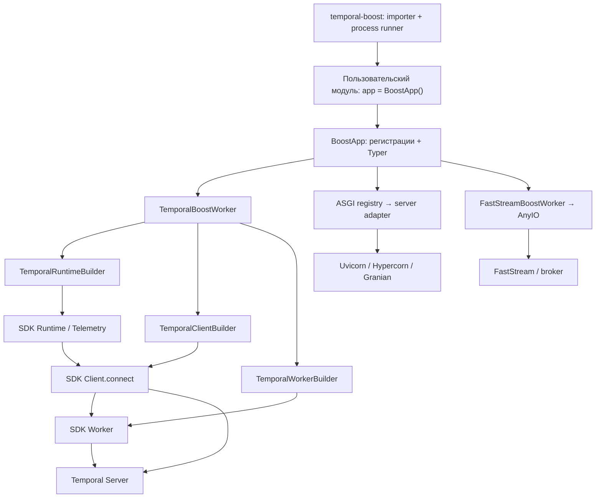

# Архитектура Temporal-boost

Документ предназначен для агентов, которые изучают и изменяют этот репозиторий. Описывает реализацию версии
`2.0.2` из [pyproject.toml](pyproject.toml), сверенную с кодом, тестами и локальной документацией.
Это карта существующей системы; ограничения ниже не являются требованиями сохранить ошибки навсегда.
Правила работы в репозитории находятся в [AGENTS.md](AGENTS.md).

## 1. Назначение и границы ответственности

Temporal-boost — небольшой слой организации приложения поверх официального Temporal Python SDK.
Он собирает именованные воркеры, создаёт для них CLI, настраивает подключение и телеметрию Temporal,
а также позволяет запускать ASGI-серверы и FastStream в одном приложении.

Основные понятия:

| Понятие | Значение в этом проекте |
| --- | --- |
| `BoostApp` | Контейнер регистраций и команд Typer; точка сборки пользовательского приложения |
| Boost worker | Объект с блокирующим `run()`, асинхронным `shutdown()` и потокобезопасным `request_stop()` (по умолчанию не поддержан) |
| `AsyncBoostWorker` | Опциональная база: один asyncio loop на запуск, cleanup в том же loop, stop из любого потока |
| `TemporalBoostWorker` | Адаптер жизненного цикла SDK worker, client и runtime |
| `TemporalWorkerBuilder` | Фабрика непосредственно `temporalio.worker.Worker` |
| `worker_name` | Локальное имя регистрации и CLI-команды |
| `task_queue` | Имя очереди на стороне Temporal; не обязано совпадать с `worker_name` |

Долговечное состояние workflow, история, повторы, маршрутизация задач и исполнение workflow принадлежат
Temporal и его SDK. В пакете нет собственной БД, workflow engine или DSL: пользователь определяет workflows,
activities, signals и queries через `temporalio`. ASGI и FastStream отвечают за HTTP и сообщения соответственно.
Фреймворк не связывает их обработчики с Temporal автоматически: в примерах обработчики сами создают SDK client
и вызывают `start_workflow()` или `execute_workflow()`.

## 2. Карта исходников и зависимости

| Путь | Ответственность |
| --- | --- |
| [temporal_boost/__init__.py](temporal_boost/__init__.py) | Корневой API: `BoostApp`, `ASGIWorkerType`, `BaseBoostWorker`, `BaseAsgiWorker`, `AsyncBoostWorker` |
| [temporal_boost/boost_app.py](temporal_boost/boost_app.py) | Регистрация воркеров, логирование, дерево Typer, запуск всех воркеров в потоках |
| [temporal_boost/common.py](temporal_boost/common.py) | Стандартный словарь Python logging |
| [temporal_boost/workers/base.py](temporal_boost/workers/base.py) | Абстрактный контракт воркера и общие параметры ASGI |
| [temporal_boost/worker_coordinator.py](temporal_boost/worker_coordinator.py) | Запуск потоков, SIGINT/SIGTERM, кооперативная остановка и общий deadline |
| [temporal_boost/workers/async_worker.py](temporal_boost/workers/async_worker.py) | Владение asyncio loop, планирование stop и однократного cleanup в нём |
| [temporal_boost/workers/temporal.py](temporal_boost/workers/temporal.py) | Сборка и запуск Temporal worker; отдельный режим CRON |
| [temporal_boost/temporal/config.py](temporal_boost/temporal/config.py) | Чтение env и значения по умолчанию |
| [temporal_boost/temporal/client.py](temporal_boost/temporal/client.py) | `TemporalClientBuilder`: параметры подключения и data converter |
| [temporal_boost/temporal/runtime.py](temporal_boost/temporal/runtime.py) | `TemporalRuntimeBuilder`: SDK runtime и telemetry |
| [temporal_boost/temporal/worker.py](temporal_boost/temporal/worker.py) | `TemporalWorkerBuilder`: очередь, activities, workflows, concurrency, interceptors |
| [temporal_boost/workers/asgi_registry.py](temporal_boost/workers/asgi_registry.py) | Реестр доступных серверов, enum и алгоритм выбора |
| [temporal_boost/workers/uvicorn_worker.py](temporal_boost/workers/uvicorn_worker.py), [hypercorn_worker.py](temporal_boost/workers/hypercorn_worker.py), [granian_worker.py](temporal_boost/workers/granian_worker.py) | Адаптеры конкретных ASGI-серверов |
| [temporal_boost/workers/faststream_worker.py](temporal_boost/workers/faststream_worker.py) | Запуск экземпляра FastStream через AnyIO |
| [temporal_boost/workers/__init__.py](temporal_boost/workers/__init__.py) | Экспорты адаптеров; импорт модулей вызывает регистрацию ASGI-реализаций |
| [temporal_boost/cli/runner.py](temporal_boost/cli/runner.py) | Установленная команда `temporal-boost` |
| [temporal_boost/cli/importer.py](temporal_boost/cli/importer.py) | Импорт объекта по пути `module:attribute`, включая вложенные атрибуты |
| [temporal_boost/cli/process_runner.py](temporal_boost/cli/process_runner.py) | Запуск приложения в одном или нескольких процессах |
| [temporal_boost/cli/prometheus.py](temporal_boost/cli/prometheus.py) | Подготовка `PROMETHEUS_MULTIPROC_DIR` перед многопроцессным запуском |

Направление зависимостей: приложение → адаптеры → builders → Temporal SDK.
Модуль `temporal/` не зависит от `BoostApp`; builders можно использовать самостоятельно.



Базовые зависимости: `temporalio`, `pydantic`, `typer`, `pyyaml`. `click` используется напрямую,
но отдельной прямой зависимостью не объявлен. Extras `uvicorn`, `hypercorn`, `granian`, `faststream`
подключают соответствующие интеграции; extra `faststream` также включает `anyio`.
Точные разрешённые версии находятся в [uv.lock](uv.lock). Сборка wheel использует `uv_build`, пакет лежит
в корне репозитория (`module-root = ""`), поддерживается Python 3.10+.

## 3. Сборка приложения и публичные контракты

Создание `BoostApp` сразу настраивает глобальное Python logging, сохраняет общие Temporal-настройки
и создаёт группы команд `run`, `cron`, `exec`. Подключение к Temporal на этом этапе не открывается.

| Метод | Что регистрирует | Возвращает |
| --- | --- | --- |
| `add_worker(name, task_queue, ...)` | `TemporalBoostWorker`; команду `run <name>`; при наличии обоих CRON-параметров — `cron <name>` | Созданный `TemporalBoostWorker` |
| `add_asgi_worker(name, app, host, port, ...)` | Выбранный ASGI-адаптер и `run <name>` | `None` |
| `add_faststream_worker(name, app, ...)` | `FastStreamBoostWorker` и `run <name>` | Созданный `FastStreamBoostWorker` |
| `add_async_runtime(name, boost_worker)` | Уже созданный объект и его `run()` | `None` |
| `add_exec_method_sync(name, callback)` | Синхронный callback как `exec <name>` | `None` |
| `get_registered_workers()` | Возвращает поверхностную копию общего списка | `list[BaseBoostWorker]` |

При добавлении воркеров запрещены имена `run`, `cron`, `exec`, `all`; имена проверяются на дублирование
среди всех типов в `_registered_workers`. В Temporal worker должен быть хотя бы один workflow или activity.
Регистрация не проверяет их декораторы и совместимость с SDK — дальнейшая валидация выполняется при сборке SDK worker.

`add_worker()` передаёт `**worker_kwargs` в `TemporalWorkerBuilder`, затем в SDK `Worker`.
Параметры подключения задаются через `BoostApp` или `worker.configure_temporal_client()`, а параметры
телеметрии — через `worker.configure_temporal_runtime()`. Это разные каналы конфигурации.
В частности, `interceptors` в `add_worker()` относятся к SDK worker; client interceptors передаются отдельно
через `configure_temporal_client(**kwargs)`.

`add_async_runtime()` аннотирован параметром `TemporalBoostWorker`, хотя выполняет только регистрацию `run()`
и добавление объекта в общий список. Он не применяет общие Temporal-настройки, не регистрирует CRON-команду
и не присваивает переданное имя полю `boost_worker.name`. Эти особенности нужно учитывать при расширении API.
Списки `_registered_cron_workers` и `_registered_asgi_workers` не управляют запуском: первый лишь пополняется,
второй остаётся пустым; фактический источник для `run all` — `_registered_workers`.

## 4. Жизненный цикл Temporal worker

Обычный запуск проходит следующую цепочку:

1. `TemporalBoostWorker.run()` вызывает `asyncio.run(self._run_worker())`.
2. `_build_worker()` создаёт client builder, если он ещё не настроен.
3. Свойство `temporal_client_runtime` лениво создаёт runtime builder и кеширует собранный SDK `Runtime`.
4. Runtime передаётся в client builder; `await build()` вызывает `Client.connect(...)` и сохраняет client.
5. Client передаётся в worker builder; синхронный `build()` создаёт SDK `Worker`.
6. `_run_worker()` логирует состав activities/workflows и ожидает `temporal_worker.run()`.
7. При выходе из этого ожидания `finally` вызывает `await shutdown()`, который делегирует SDK worker.

`CancelledError` во время ожидания обычного worker логируется и подавляется; остальные `Exception`
логируются и пробрасываются. Сама `_build_worker()` расположена до `try/finally`: ошибка подключения
или сборки не проходит через этот блок cleanup.

Свойства `temporal_client` и `temporal_worker` до сборки выбрасывают `RuntimeError`.
`configure_temporal_client()` создаёт или изменяет builder, а не устанавливает соединение.
`configure_temporal_runtime()` заменяет builder, но не сбрасывает уже созданный `_runtime`.
Все настройки следует задавать до запуска и до первого обращения к `temporal_client_runtime`:
изменение builder не перенастраивает существующие SDK-объекты.

Каждый `TemporalBoostWorker` по умолчанию создаёт свой runtime и client. Автоматического разделения
одного runtime между воркерами нет. Отдельно используемый `TemporalClientBuilder` при отсутствии
явного runtime берёт `Runtime.default()`; адаптер worker всегда передаёт собственный runtime.

### Режим CRON

`cron <name>` вызывает `TemporalBoostWorker.cron()` → `asyncio.run(_run_with_cron())`:

1. Собираются runtime, client и worker по обычной цепочке.
2. SDK worker запускается через `async with self.temporal_worker`.
3. Через `client.start_workflow()` запускается `cron_runner` с новым UUID в качестве workflow ID,
   очередью этого worker и строкой `cron_schedule`.
4. Метод ждёт незавершённый `_cron_future`; при отмене выходит из контекстного менеджера SDK worker.

Это SDK `cron_schedule`, а не отдельный ресурс Temporal Schedule и не локальный планировщик.
Аргументы workflow этим API не передаются; `cron_runner` типизирован как метод без параметров workflow.
Повторный запуск создаёт другой workflow ID: дедупликации по имени worker нет. Закрытие локального worker
не сопровождается вызовом отмены или удаления запущенного на сервере workflow.

**`run <name>` и `run all` всегда вызывают `run()`, даже для CRON-регистраций. Они обслуживают очередь,
но не вызывают `start_workflow()` для расписания. Для этого нужен отдельный `cron <name>`.**

## 5. CLI, потоки и процессы

Есть два уровня CLI. Пользовательское приложение вызывает `app.run()` и предоставляет своё дерево команд:

```bash
uv run python main.py run all
uv run python main.py run activity_worker
uv run python main.py cron daily_report
uv run python main.py exec migrate_db
```

Программно аргументы передаются единым списком: `app.run(["run", "activity_worker"])`.
Метод делегирует вызов Typer, перехватывает `SystemExit` и только логирует код: вызывающая программа
не получает этот exit code автоматически. Вызов `app.run("run", "activity_worker")` не эквивалентен списку.

Установленная entry point `temporal-boost = temporal_boost.cli.runner:cli_app` импортирует объект приложения
и передаёт ему список аргументов. В текущем дереве Typer всего одна команда, поэтому внешний уровень
сворачивается; фактический синтаксис, проверенный через `--help`:

```bash
uv run temporal-boost service.main:app run all
uv run temporal-boost --workers 3 service.main:app run activity_worker
```

Здесь `run` после `service.main:app` относится к CLI самого приложения. Дополнительный `run` перед путём
приложения не требуется. `import_app_object()` поддерживает `module:attribute.nested`; при неудаче импорта
пробует добавить текущий или родительский каталог в `sys.path`. Строгой проверки типа `BoostApp` нет:
runner вызывает `.run(arguments)` у импортированного объекта.

| Режим | Модель исполнения | Поведение при завершении |
| --- | --- | --- |
| `app.run()` → `run <name>` | Один блокирующий worker в текущем потоке | Управляется конкретным адаптером |
| `app.run()` → `run all` | По одному daemon-потоку `worker-<name>`; coordinator проверяет stop раз в 50 мс | Первая ошибка останавливает остальные worker и пробрасывается после stop/join с общим deadline |
| Внешний CLI, `--workers <= 1` | Импорт приложения и вызов его CLI в текущем процессе | `KeyboardInterrupt` перехватывается runner |
| Внешний CLI, `--workers > 1` | Несколько `multiprocessing.Process`, каждый запускает тот же набор команд | Родитель делает `join()`; при `KeyboardInterrupt` — `terminate()`, ожидание до 5 секунд и при необходимости `kill()` |

Количество процессов не распределяет регистрации: `--workers 3 ... run all` запускает весь набор
в каждом из трёх процессов. Для ASGI это может создавать конфликт одного HTTP-порта.
В process runner нет перезапуска упавших процессов и передачи их ненулевого exit code родителю:
код завершения только записывается в лог.

`run_all_workers()` временно устанавливает обработчики SIGINT/SIGTERM только при запуске в главном потоке
и восстанавливает прежние при выходе, включая ошибки. Обработчики и явный `app.stop()` только отмечают
запрос; coordinator запускает единый путь остановки. Повторный stop не сокращает и не продлевает deadline.
Из другого потока сигналы не настраиваются: вызывающий код использует `app.stop()` и ожидает возврата запуска.
До/после запуска `stop()` не влияет на следующий запуск; регистрации завершаются до запуска coordinator.

`BoostApp(shutdown_timeout=30.0)` задаёт общий бюджет stop/join в секундах: конечное число >= 0.
Все живые worker получают неблокирующий `request_stop()` до ожидания потоков; coordinator не вызывает
async `shutdown()` самостоятельно. При превышении бюджета поднимается `TimeoutError` с именами worker
(если ранее уже была ошибка, timeout логируется, а исходная ошибка остаётся основной);
daemon-потоки могут продолжать работу до выхода процесса. Повторный запуск запрещён, пока они живы,
как и одновременный вызов `run_all_workers()`.

Обёртка каждого потока перехватывает `BaseException` из `worker.run()` и передаёт исходный объект
с traceback через `SimpleQueue` координатору. Первая опубликованная ошибка инициирует stop;
после ограниченного cleanup coordinator логирует накопленные ошибки и поднимает первую. Тот же FIFO
сохраняет порядок ошибок запуска потоков, stop-запросов и timeout; последующий отказ не скрывает первый.
Ошибки stop callback не прерывают рассылку stop остальным worker. При замеченном stop запуск следующих
регистраций прекращается. Исключения worker не уходят в `threading.excepthook`.

`run all` считает worker долгоживущими: возврат `run()` до запроса остановки приложения — `RuntimeError`
с именем worker и остановкой остальных. Для finite worker миграция — `app.stop()` перед возвратом
или отдельная команда `run <name>`. Возврат после stop — штатное завершение. `asyncio.CancelledError`
и `concurrent.futures.CancelledError` штатны только после запроса stop; до него они пробрасываются.
Остальные исключения, включая `SystemExit` / `KeyboardInterrupt`, фатальны и во время shutdown.
Поведение внешнего CLI/кодов завершения остаётся в TB-008/TB-009: `BoostApp.run()` всё ещё перехватывает
`SystemExit`, а supervisor не передаёт код дочернего процесса. Внутренняя команда Typer `run all`
проверена через `CliRunner` на ненулевой код при обычной ошибке worker.

`BaseBoostWorker.request_stop()` по умолчанию возвращает `False` с диагностикой coordinator о неподдержанном
stop. Новая база `AsyncBoostWorker` реализует opt-in: подкласс вызывает `super().__init__()`, определяет
`name`, async `run_async()` и `shutdown()`. `run()` владеет loop через `asyncio.run()`, а потокобезопасный
`request_stop()` запоминает ранний запрос и использует `call_soon_threadsafe()` для уведомления loop.
`shutdown()` выполняется один раз в этом loop при stop или нормальном возврате/ошибке `run_async()`;
он должен быть безопасен при частичном старте и обеспечить возврат `run_async()`. После него helper
дожидается основной coroutine, закрывает loop; повторный последовательный запуск создаёт новый loop.
Ошибка `run_async()` сохраняется, если его собственный `shutdown()` тоже выбросил исключение:
cleanup error логируется. При отмене основной coroutine ошибка cleanup пробрасывается, чтобы штатная
отмена при stop не скрыла отказ cleanup. Ошибки собственных cleanup путей существующих адаптеров
остаются ответственностью адаптеров (в частности, TB-005 для Temporal).

Существующие Temporal/FastStream/ASGI адаптеры пока не подключены к контракту managed stop
(TB-005/TB-013/TB-014). Их собственный cleanup не гарантирует общего graceful shutdown; stop может
завершиться timeout. Отдельные CLI-команды и внешний supervisor процессов остаются вне этого coordinator.
Бюджет приложения не связан с `TEMPORAL_GRACEFUL_SHUTDOWN_TIMEOUT`: TB-004 подключает эту настройку
к grace period activities в SDK, но не инициирует stop и не подключает Temporal adapter к coordinator.

## 6. Конфигурация: фактическая семантика

`temporal_boost.temporal.config` читает env **при импорте** и сохраняет обычные модульные константы.
Автоматической загрузки `.env` в пакете нет. Окружение нужно подготовить до импорта `temporal_boost`.
Дополнительно значения по умолчанию аргументов runtime-конфигурации фиксируются при определении функций:
простая замена константы после импорта не обновляет эти defaults.

Для endpoint и namespace практический приоритет следующий: последний явный вызов
`worker.configure_temporal_client(...)` → параметры `BoostApp` → env-константы → встроенные defaults.
В конструкторах builders строки выбираются через `value or config.VALUE`; пустая строка попадает в fallback.
Поздние setters принимают и пустые строки, поскольку проверяется `is not None`.

| Переменная окружения | Default | Где используется |
| --- | --- | --- |
| `TEMPORAL_TARGET_HOST` | `localhost:7233` | Адрес в `Client.connect()` |
| `TEMPORAL_NAMESPACE` | `default` | Namespace client |
| `TEMPORAL_TLS` | `False` | TLS client; явный `tls=False` поддерживается |
| `TEMPORAL_API_KEY`, `TEMPORAL_IDENTITY` | `None` | Авторизация и identity client |
| `TEMPORAL_USE_PYDANTIC_DATA_CONVERTER` | `False` | Выбор SDK Pydantic converter; явный bool перекрывает env |
| `TEMPORAL_MAX_CONCURRENT_WORKFLOW_TASKS` | `300` | SDK worker concurrency |
| `TEMPORAL_MAX_CONCURRENT_ACTIVITIES` | `300` | SDK worker concurrency |
| `TEMPORAL_MAX_CONCURRENT_LOCAL_ACTIVITIES` | `100` | SDK worker concurrency |
| `TEMPORAL_MAX_WORKFLOW_TASK_POLLS` | `10` | Аргумент `max_concurrent_workflow_task_polls` |
| `TEMPORAL_MAX_ACTIVITY_TASK_POLLS` | `10` | Аргумент `max_concurrent_activity_task_polls` |
| `TEMPORAL_NONSTICKY_TO_STICKY_RATIO` | `0.2` | Аргумент `nonsticky_to_sticky_poll_ratio` |
| `TEMPORAL_GRACEFUL_SHUTDOWN_TIMEOUT` | `30` секунд, преобразуется в `timedelta` | Передаётся как `Worker(graceful_shutdown_timeout=...)`; явный `timedelta` в worker builder имеет приоритет |
| `TEMPORAL_PROMETHEUS_BIND_ADDRESS` | `None` | При наличии создаётся `PrometheusConfig` |
| `TEMPORAL_PROMETHEUS_COUNTERS_TOTAL_SUFFIX` | `False` | Опция `PrometheusConfig` |
| `TEMPORAL_PROMETHEUS_UNIT_SUFFIX` | `False` | Опция `PrometheusConfig` |
| `TEMPORAL_PROMETHEUS_DURATIONS_AS_SECONDS` | `False` | Опция `PrometheusConfig` |

Парсер bool принимает `true`, `1`, `yes` без учёта регистра; остальные значения дают `False`.
Ошибки преобразования int/float заменяются default. Проверки диапазонов на этом уровне нет.
Числовые параметры `TemporalWorkerBuilder` используют `value or config.VALUE`: явный `0`, в том числе
для `nonsticky_to_sticky_poll_ratio`, заменяется конфигурационным значением.

`TemporalWorkerBuilder(graceful_shutdown_timeout: timedelta | None = None)` использует env-константу
только при `None`. Явный `timedelta(0)` сохраняется; выбранная отрицательная длительность отклоняется
через `ValueError` при создании builder. Неотрицательное явное значение может перекрыть отрицательный env.
Параметр передаётся в SDK один раз; путь `add_worker(**worker_kwargs)` → `TemporalBoostWorker` → builder
сохраняет override и не оставляет его в произвольных kwargs. Чтение env по-прежнему происходит при импорте;
нецелое текстовое значение заменяется default 30 секунд существующим парсером.

Изменение TB-004: ранее при отсутствии override SDK получал собственный default `timedelta(0)`;
теперь используется framework default 30 секунд или env. После запроса SDK shutdown это grace period
для завершения activities до запроса отмены. SDK продолжает ждать activities и после отмены, поэтому
данная настройка не ограничивает общую длительность shutdown. Она не запускает остановку автоматически,
не задаёт `BoostApp.shutdown_timeout` и не меняет deadline внешнего supervisor. При managed stop бюджет
приложения должен учитывать grace period и последующий cleanup; интеграция Temporal adapter — TB-005.

### Pydantic converter

При создании `TemporalClientBuilder` значение `None` наследует env, `True` включает SDK Pydantic converter,
а `False` отключает автоматический выбор Pydantic даже при env `True`. То же правило действует при первой
настройке worker и регистрации через `BoostApp(use_pydantic=...)`. Повторный вызов
`configure_temporal_client()` меняет флаг только для явных `True` / `False`; `None` сохраняет текущий выбор.

`set_pydantic_data_converter(*, enabled: bool = True)` поддерживает включение и отключение;
вызов без аргументов по-прежнему включает Pydantic. `build()` добавляет автоматический converter в копию kwargs,
поэтому переключение `True → False` не оставляет converter от предыдущей сборки.

Явный `data_converter` из конструктора, `set_kwargs()` или `configure_temporal_client()` всегда имеет
приоритет над Pydantic-флагом и env и сохраняется при отключении флага. Без него `False` оставляет выбор
converter по умолчанию SDK. Настройки относятся к следующим сборкам client, существующий client не изменяется.

Миграция: для включения Pydantic требуется `True`, а для выбора SDK Pydantic converter нужно убрать
переданный явно `data_converter`, если ранее код полагался на его перезапись флагом.

## 7. ASGI и FastStream

### ASGI registry

`@asgi_worker_registry.register(key, packages=[...])` проверяет импорт зависимостей при загрузке модуля.
При `ImportError` класс остаётся определён, но не попадает в реестр. Это позволяет импортировать основной
пакет без установленных ASGI extras. Сами серверные API импортируются внутри `run()` / `_run_server()`.

`ASGIWorkerType.auto` предпочитает Uvicorn. Если его нет, берётся первый зарегистрированный сервер.
При текущем порядке импортов в `workers/__init__.py` резервный порядок — Granian, затем Hypercorn.
Это следствие порядка импортов, а не отдельная таблица приоритетов. Отсутствие любой реализации
или запрос недоступного сервера приводит к `RuntimeError`.

Адаптеры передают общие `app`, `host`, `port`, logging и произвольные kwargs серверу:

| Адаптер | Запуск | Cleanup |
| --- | --- | --- |
| Uvicorn | `uvicorn.Config` → `Server.run()` | `asyncio.run(server.shutdown())` |
| Hypercorn | `asyncio.run()` → task с `serve(app, config, mode="asgi")`; kwargs становятся атрибутами `Config` | Отмена task и ожидание; без task `shutdown()` выбрасывает `RuntimeError` |
| Granian | `Server(..., interface=Interfaces.ASGI).serve()` | Синхронный `server.shutdown()` внутри async-обёртки |

Путь приложения строкой передаётся самому серверу; общего импортера ASGI-приложений в адаптерах нет.
Поддержку строки и конкретных kwargs нужно проверять для выбранного backend.

### FastStream

FastStream и AnyIO импортируются при `run()`. Проверяется `isinstance(app, FastStream)`; неверный тип
даёт `TypeError`, отсутствующие импорты — `RuntimeError`. Запуск выполняется как
`anyio.run(app.run, log_level, faststream_kwargs)`: словарь передаётся вторым позиционным аргументом,
а не разворачивается в `**kwargs`. При обновлении FastStream необходимо сверять эту сигнатуру.

Адаптер устанавливает уровень логгера `faststream`, перехватывает прерывание/отмену и вызывает свой
`shutdown()` в `finally`. Этот `shutdown()` только логирует завершение; прямого вызова закрытия broker
в нём нет. Жизненный цикл ресурсов FastStream зависит от `app.run()`.

## 8. Логирование и телеметрия

`BoostApp(logger_config=...)` поддерживает словарь, путь к JSON/YAML или другой файл для `logging.config.fileConfig()`.
`None` оставляет logging без настройки со стороны приложения. Ошибка конфигурации оборачивается в `RuntimeError`.
[DEFAULT_LOGGING_CONFIG](temporal_boost/common.py) выводит логи в stdout с уровнем DEBUG и
`disable_existing_loggers=False`. Создание нескольких `BoostApp` может повторно перенастраивать глобальное logging.
ASGI-адаптер получает сохранённый словарь конфигурации; при `fileConfig()` такой словарь не формируется.

SDK telemetry настраивается отдельно в `TemporalRuntimeBuilder`: logging, metrics, global tags,
service name и prefix. Поддерживаются SDK `PrometheusConfig`, `OpenTelemetryConfig`, `MetricBuffer`.
Явно переданный `metrics` имеет приоритет перед автоматическим `PrometheusConfig` из bind address.

При `ValueError`, содержащем `Address already in use`, и заданном `prometheus_bind_address` builder
повторяет создание runtime с пустым `TelemetryConfig()`. В этой ветке теряется вся пользовательская
telemetry-конфигурация, включая tags и logging. Прочие `ValueError` пробрасываются.
Если конфликтующий Prometheus задан только через `metrics=PrometheusConfig(...)`, а поле bind address
builder равно `None`, эта fallback-ветка не срабатывает.

Перед многопроцессным запуском CLI создаёт или проверяет `PROMETHEUS_MULTIPROC_DIR`.
Это отдельная переменная от `TEMPORAL_PROMETHEUS_BIND_ADDRESS`. В коде нет объединения SDK-метрик
процессов в общий exporter; наличие каталога само по себе не решает конфликт порта нескольких runtimes.
Автоматической очистки временного каталога также нет.

## 9. Где документация расходится с кодом

При работе с этими областями сначала проверяйте реализацию и добавляйте тест на требуемое поведение.

| Утверждение или пример | Фактическое состояние |
| --- | --- |
| Env имеет высший приоритет в [configuration.md](docs/configuration.md) и [creating_application.md](docs/creating_application.md) | Явные endpoint/namespace `BoostApp` перекрывают env; поздняя настройка worker перекрывает их |
| `use_pydantic` описан как bool override в [api_reference.md](docs/api_reference.md) | `False` обрабатывается некорректно; детали в разделе 6 |
| Graceful shutdown в [running_application.md](docs/running_application.md) | Coordinator поддерживает opt-in worker и отдельный `BoostApp.shutdown_timeout`; адаптеры ещё не подключены. `GRACEFUL_SHUTDOWN_TIMEOUT` задаёт отдельный grace period activities в SDK |
| Автоматически общий runtime в [advanced_usage.md](docs/advanced_usage.md) | Каждый `TemporalBoostWorker` создаёт свой runtime |
| Пример custom runtime в [advanced_usage.md](docs/advanced_usage.md) | Построенный отдельно runtime не влияет на client без `client_builder.set_runtime(runtime)` до `build()` |
| Удалённые тесты в [release_notes_2.0.0.md](docs/release_notes_2.0.0.md) | Это исторические release notes; актуальная suite существует в `tests/` |
| `TestAsyncRuntime` в [example_app.py](examples/example_app.py) | У класса нет обязательного `shutdown()`; как есть он абстрактен и не зарегистрирован в приложении |

Примеры и guides полезны для сценариев использования, но сами по себе не подтверждают работоспособность
конкретной сигнатуры SDK или интеграции с текущим lockfile.

## 10. Навигация для изменений

| Задача | Основные файлы | Тесты и сопутствующие материалы |
| --- | --- | --- |
| Регистрация, имена, команды приложения | `boost_app.py` | `tests/test_boost_app.py`, `docs/creating_application.md`, `docs/api_reference.md` |
| Client, TLS, identity, converter | `temporal/client.py`, `workers/temporal.py`, `temporal/config.py` | `tests/test_temporal_client.py`, `tests/test_temporal_worker.py`, `docs/configuration.md` |
| Worker options, concurrency, interceptors | `temporal/worker.py`, `workers/temporal.py` | `tests/test_temporal_worker.py`, `docs/configuration.md`, `docs/advanced_usage.md` |
| CRON или Temporal lifecycle | `workers/temporal.py`, `boost_app.py` | `tests/test_temporal_worker.py`, `tests/test_boost_app.py`, `examples/example_cron.py` |
| Telemetry и конфликт metrics-порта | `temporal/runtime.py`, `cli/prometheus.py`, `cli/process_runner.py` | `tests/test_temporal_runtime.py`, `docs/advanced_usage.md` |
| ASGI backend | `workers/asgi_registry.py`, соответствующий адаптер, `workers/__init__.py` | `tests/test_asgi_registry.py`, `pyproject.toml` extras, `examples/example_fastapi.py` |
| FastStream | `workers/faststream_worker.py`, `boost_app.py` | `docs/faststream_integration.md`, `examples/example_*faststream*.py` |
| Внешний CLI и процессы | `cli/runner.py`, `cli/importer.py`, `cli/process_runner.py` | Нужны отдельные тесты этих модулей; CLI проверить через `--help` и `CliRunner` |

При добавлении нового ASGI backend реализуйте `BaseAsgiWorker`, зарегистрируйте класс с проверкой
зависимостей, обеспечьте импорт модуля для выполнения декоратора, добавьте enum/extra при необходимости.
При добавлении иного worker реализуйте `run()` / `shutdown()` и неблокирующий потокобезопасный
`request_stop()`; для asyncio можно наследовать `AsyncBoostWorker`. Определите владение event loop
и ресурсами. Синхронный `run()` может выполняться в daemon-потоке.

Для новой env-настройки проследите полный путь: `config.py` → аргумент builder → вызов SDK → путь настройки
через app/worker → тест → документация. Одного объявления константы недостаточно.
Сохраняйте разделение client, runtime и worker options и возможность импортировать базовый пакет без extras.
Изменения публичных экспортов проверяйте в обоих `__init__.py`; workflow/activity decorators и task queues
остаются частью пользовательского приложения.

## 11. Проверки и ограничения тестов

Основные тесты используют `unittest.mock`, `AsyncMock` и `pytest-asyncio`; подключения client и SDK worker
подменяются. Temporal Server для этой suite не требуется. Однако часть `test_temporal_runtime.py`
создаёт настоящий SDK runtime и открывает Prometheus-порты `9090`/`9091`: нужны доступные порты и разрешение
на локальный bind. В ограниченной песочнице возможен `Operation not permitted`.

Покрыты регистрация, env parsers, builders, часть свойств и настройки lifecycle, ASGI registry и logging.
Отдельных тестов внешнего CLI, процессов, FastStream и реального запуска ASGI-адаптеров нет.
CRON и длительно работающие циклы адаптеров также не проверены полноценно. Coordinator покрыт
управляемыми worker: cleanup в собственном loop, повторный stop, общий timeout, повторный запуск,
отказ запуска потока. SIGINT/SIGTERM и восстановление обработчиков проверяются отдельными subprocess
в `tests/test_worker_coordinator.py`. TB-003 добавляет наблюдаемую ошибку при работающем peer,
первенство исходной ошибки перед отказами cleanup и timeout, unexpected return, классификацию
отмены до/после stop и внутренний CLI. Искусственные отказы проверяются с
`-W error::pytest.PytestUnhandledThreadExceptionWarning`. Suite не доказывает graceful shutdown реальных адаптеров.

В `tests/test_boost_app.py` два метода названы `test_run_with_args`: Python оставляет только второй.
Тест `test_run_all_workers_with_workers` теперь проверяет нормальный возврат mock worker;
искусственный `KeyboardInterrupt` и соответствующее `PytestUnhandledThreadExceptionWarning` удалены в TB-002.

Рабочие команды из корня репозитория:

```bash
uv sync --locked
uv sync --locked --extra faststream --extra uvicorn  # при работе с интеграциями
uv run pytest tests/ --cov=temporal_boost --cov-report=term
uv run ruff check temporal_boost/ examples/
uv run ruff format --check temporal_boost/ examples/
uv run mypy temporal_boost/
uv run mkdocs build --strict
```

В существующем подготовленном окружении `uv run --no-sync ...` позволяет выполнять проверки без
повторной синхронизации. Ruff настроен с `fix=true` и `unsafe-fixes=true`; для диагностики без изменения
файлов используйте `ruff check --no-fix ...`.

[CI](.github/workflows/ci_prepare.yml) запускает тесты на Python 3.10–3.13. Некоторые шаги,
включая mypy и проверки примеров, имеют `|| true`: успешный workflow не гарантирует их успешность.
MkDocs публикует содержимое `docs/` по [mkdocs.yml](mkdocs.yml); корневой `ARCHITECTURE.md` автоматически
в сайт не включается. Правила и команды разработки уточняйте по `AGENTS.md` и `pyproject.toml`.

При изменении связей модулей, порядка запуска или семантики настроек обновляйте соответствующий раздел
этого документа вместе с кодом и тестами. Для поиска внешней документации зависимостей используйте Context7
согласно правилам репозитория.
