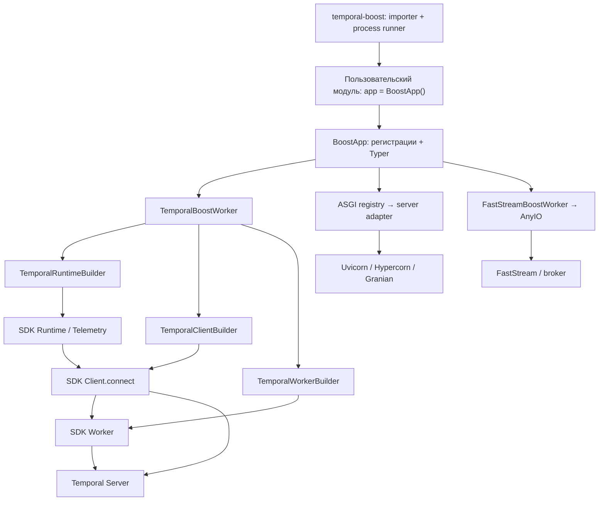

# Архитектура Temporal-boost

Документ предназначен для агентов, которые изучают и изменяют этот репозиторий. Описывает реализацию версии
`2.0.2` из [pyproject.toml](pyproject.toml), сверенную с кодом, тестами и локальной документацией.
Это карта существующей системы; ограничения ниже не являются требованиями сохранить ошибки навсегда.
Правила работы в репозитории находятся в [AGENTS.md](AGENTS.md).

## 1. Назначение и границы ответственности

Temporal-boost — небольшой слой организации приложения поверх официального Temporal Python SDK.
Он собирает именованные воркеры, создаёт для них CLI, настраивает подключение и телеметрию Temporal,
а также позволяет запускать ASGI-серверы и FastStream в одном приложении.

Основные понятия:

| Понятие | Значение в этом проекте |
| --- | --- |
| `BoostApp` | Контейнер регистраций и команд Typer; точка сборки пользовательского приложения |
| Boost worker | Объект с блокирующим `run()`, асинхронным `shutdown()` и потокобезопасным `request_stop()` (по умолчанию не поддержан) |
| `AsyncBoostWorker` | Опциональная база: один asyncio loop на запуск, cleanup в том же loop, stop из любого потока |
| `TemporalBoostWorker` | Адаптер жизненного цикла SDK worker, client и runtime |
| `TemporalWorkerBuilder` | Фабрика непосредственно `temporalio.worker.Worker` |
| `worker_name` | Локальное имя регистрации и CLI-команды |
| `task_queue` | Имя очереди на стороне Temporal; не обязано совпадать с `worker_name` |

Долговечное состояние workflow, история, повторы, маршрутизация задач и исполнение workflow принадлежат
Temporal и его SDK. В пакете нет собственной БД, workflow engine или DSL: пользователь определяет workflows,
activities, signals и queries через `temporalio`. ASGI и FastStream отвечают за HTTP и сообщения соответственно.
Фреймворк не связывает их обработчики с Temporal автоматически: в примерах обработчики сами создают SDK client
и вызывают `start_workflow()` или `execute_workflow()`.

## 2. Карта исходников и зависимости

| Путь | Ответственность |
| --- | --- |
| [temporal_boost/__init__.py](temporal_boost/__init__.py) | Корневой API: `BoostApp`, `ASGIWorkerType`, `BaseBoostWorker`, `BaseAsgiWorker`, `AsyncBoostWorker` |
| [temporal_boost/boost_app.py](temporal_boost/boost_app.py) | Регистрация воркеров, логирование, дерево Typer, запуск всех воркеров в потоках |
| [temporal_boost/common.py](temporal_boost/common.py) | Стандартный словарь Python logging |
| [temporal_boost/workers/base.py](temporal_boost/workers/base.py) | Абстрактный контракт воркера и общие параметры ASGI |
| [temporal_boost/worker_coordinator.py](temporal_boost/worker_coordinator.py) | Запуск потоков, SIGINT/SIGTERM, кооперативная остановка и общий deadline |
| [temporal_boost/workers/async_worker.py](temporal_boost/workers/async_worker.py) | Владение asyncio loop, планирование stop и однократного cleanup в нём |
| [temporal_boost/workers/temporal.py](temporal_boost/workers/temporal.py) | Сборка и запуск Temporal worker; отдельный режим CRON |
| [temporal_boost/temporal/config.py](temporal_boost/temporal/config.py) | Чтение env и значения по умолчанию |
| [temporal_boost/temporal/client.py](temporal_boost/temporal/client.py) | `TemporalClientBuilder`: параметры подключения и data converter |
| [temporal_boost/temporal/runtime.py](temporal_boost/temporal/runtime.py) | `TemporalRuntimeBuilder`: SDK runtime и telemetry |
| [temporal_boost/temporal/worker.py](temporal_boost/temporal/worker.py) | `TemporalWorkerBuilder`: очередь, activities, workflows, concurrency, interceptors |
| [temporal_boost/workers/asgi_registry.py](temporal_boost/workers/asgi_registry.py) | Реестр доступных серверов, enum и алгоритм выбора |
| [temporal_boost/workers/uvicorn_worker.py](temporal_boost/workers/uvicorn_worker.py), [hypercorn_worker.py](temporal_boost/workers/hypercorn_worker.py), [granian_worker.py](temporal_boost/workers/granian_worker.py) | Адаптеры конкретных ASGI-серверов |
| [temporal_boost/workers/faststream_worker.py](temporal_boost/workers/faststream_worker.py) | Запуск экземпляра FastStream через AnyIO |
| [temporal_boost/workers/__init__.py](temporal_boost/workers/__init__.py) | Экспорты адаптеров; импорт модулей вызывает регистрацию ASGI-реализаций |
| [temporal_boost/cli/runner.py](temporal_boost/cli/runner.py) | Установленная команда `temporal-boost` |
| [temporal_boost/cli/importer.py](temporal_boost/cli/importer.py) | Импорт объекта по пути `module:attribute`, включая вложенные атрибуты |
| [temporal_boost/cli/process_runner.py](temporal_boost/cli/process_runner.py) | Запуск приложения в одном или нескольких процессах |

Направление зависимостей: приложение → адаптеры → builders → Temporal SDK.
Модуль `temporal/` не зависит от `BoostApp`; builders можно использовать самостоятельно.



Базовые зависимости: `temporalio`, `pydantic`, `typer`, `pyyaml`. `click` используется напрямую,
но отдельной прямой зависимостью не объявлен. Extras `uvicorn`, `hypercorn`, `granian`, `faststream`
подключают соответствующие интеграции; extra `faststream` также включает `anyio`.
Точные разрешённые версии находятся в [uv.lock](uv.lock). Сборка wheel использует `uv_build`, пакет лежит
в корне репозитория (`module-root = ""`), поддерживается Python 3.10+.

## 3. Сборка приложения и публичные контракты

Создание `BoostApp` сразу настраивает глобальное Python logging, сохраняет общие Temporal-настройки
и создаёт группы команд `run`, `cron`, `exec`. Подключение к Temporal на этом этапе не открывается.

| Метод | Что регистрирует | Возвращает |
| --- | --- | --- |
| `add_worker(name, task_queue, ...)` | `TemporalBoostWorker`; команду `run <name>`; при наличии обоих CRON-параметров — `cron <name>` | Созданный `TemporalBoostWorker` |
| `add_asgi_worker(name, app, host, port, ...)` | Выбранный ASGI-адаптер и `run <name>` | `None` |
| `add_faststream_worker(name, app, ...)` | `FastStreamBoostWorker` и `run <name>` | Созданный `FastStreamBoostWorker` |
| `add_async_runtime(name, boost_worker)` | Уже созданный `BaseBoostWorker`, каноническое имя и его `run()` | `None` |
| `add_exec_method_sync(name, callback)` | Синхронный callback как `exec <name>` | `None` |
| `get_registered_workers()` | Возвращает поверхностную копию общего списка | `list[BaseBoostWorker]` |

При добавлении воркеров запрещены имена `run`, `cron`, `exec`, `all`; имена проверяются на дублирование
среди всех типов в `_registered_workers`. В Temporal worker должен быть хотя бы один workflow или activity.
Регистрация не проверяет их декораторы и совместимость с SDK — дальнейшая валидация выполняется при сборке SDK worker.
В TB-018 все четыре метода регистрации используют общие `_validate_worker_registration()` и
`_register_worker()`: factories проверяют имя до создания объекта, а общий путь повторно валидирует
имя и identity, присваивает `worker.name`, регистрирует CLI callback и добавляет объект в единый список.
Повторная регистрация одного объекта под тем же или другим именем в одном app запрещена до мутаций.
Каноническое имя определяет CLI, имена в `get_registered_workers()`, logs и потоки `worker-<name>`.
После регистрации имя менять нельзя; для каждой регистрации в другом app нужен отдельный экземпляр.

`add_worker()` передаёт `**worker_kwargs` в `TemporalWorkerBuilder`, затем в SDK `Worker`.
Параметры подключения задаются через `BoostApp` или `worker.configure_temporal_client()`, а параметры
телеметрии — через `worker.configure_temporal_runtime()`. Это разные каналы конфигурации.
В частности, `interceptors` в `add_worker()` относятся к SDK worker; client interceptors передаются отдельно
через `configure_temporal_client(**kwargs)`.

`add_async_runtime()` принимает `BaseBoostWorker` (аннотация расширена ещё в TB-002); обязательны
`run()` и async `shutdown()`, managed stopping требует `request_stop()` или базы `AsyncBoostWorker`.
Метод сохраняет настройки заранее созданного Temporal worker: не применяет общие endpoint/namespace/
Pydantic/debug настройки app, не пересчитывает `cron_workflow_id` и не регистрирует CRON-команду.
Это прежняя семантика конфигурации. Для применения app defaults и регистрации CRON используется
`add_worker()`. Сигнатура custom `run()` сохраняется для отдельной CLI-команды; `run all` вызывает её
без аргументов. `get_registered_workers()` возвращает shallow copy единственного registry.

Неиспользуемые `_registered_cron_workers` и `_registered_asgi_workers` удалены в TB-018; CRON-команды
по-прежнему регистрируются по конфигурации `add_worker()`. Миграция: alias теперь становится именем
объекта, повторные aliases одного экземпляра отклоняются; прежнее внутреннее имя нужно хранить отдельно,
если оно используется как application data. Новый типизируемый пример —
[example_custom_worker.py](examples/example_custom_worker.py); старый `TestAsyncRuntime` остаётся TB-024.

## 4. Жизненный цикл Temporal worker

Обычный запуск проходит следующую цепочку:

1. `TemporalBoostWorker.run()` вызывает `asyncio.run(self._run_worker())`.
2. Общий `_run_lifecycle()` привязывает текущие task/loop и создаёт stop event; состояние — `building`.
   `_build_worker()` в отдельной task создаёт client builder, если он ещё не настроен.
3. Свойство `temporal_client_runtime` лениво создаёт runtime builder и кеширует собранный SDK `Runtime`.
4. Runtime передаётся в client builder; `await build()` вызывает `Client.connect(...)` и сохраняет client.
5. Client передаётся в worker builder; синхронный `build()` создаёт SDK `Worker`.
6. Состояние — `running`; adapter владеет отдельной task `temporal_worker.run()` и наблюдает её вместе
   со stop event (в CRON-режиме — также task регистрации).
7. Единый `finally` охватывает сборку и исполнение: состояние — `stopping`, startup/CRON tasks отменяются
   и дожидаются; активный SDK run останавливается через публичный `Worker.shutdown()` в том же loop.
8. Ссылки adapter и builders на worker/client/runtime снимаются, локальные tasks/future очищаются,
   loop/owner task отвязываются, состояние — `stopped`. `asyncio.run()` закрывает loop при возврате.

Начальное состояние — `created`; ранняя остановка или ошибка может пропустить `running`.
Readonly `state` показывает текущее состояние. Последовательные запуски после остановки/ошибки допустимы:
новый запуск создаёт свежие loop/client/runtime/SDK worker. Одновременные `run()` / `cron()` одного
adapter запрещены. Поздний stop после остановки не переносится в следующий запуск.

`request_stop()` потокобезопасен и не блокирует: до первого запуска запрос запоминается и предотвращает
создание ресурсов, при активном запуске доставляется в owning loop через `call_soon_threadsafe()`.
`shutdown()` до/после запуска безопасен и ничего не делает; на активном owning loop запрашивает stop
и через `shield()` ждёт lifecycle task. Повторные вызовы разделяют cleanup; отмена одного ожидающего
не отменяет lifecycle. Из чужого loop вызов отклоняется с указанием использовать `request_stop()`;
из callback самого worker также следует запрашивать stop без ожидания собственного завершения.

Ошибки runtime/client/worker build и исполнения сохраняют исходный объект и traceback после cleanup;
вторичный отказ cleanup логируется. Неожиданный `CancelledError` больше не подавляется. Повторная отмена
owner task не бросает cleanup: он защищён отдельной task и `shield()`. При ошибке cleanup на фоне отмены
основным становится cleanup error, чтобы coordinator не принял его за штатную отмену.

SDK `shutdown()` вызывается не более одного раза при активном SDK run. Завершившийся SDK run сам
выполняет cleanup; adapter получает его результат и не вызывает shutdown ещё раз. Если SDK run падает
на валидации до фактического запуска, его `shutdown()` может ждать бесконечно: adapter наблюдает run task
одновременно с shutdown task и отменяет лишнее ожидание. Отказ SDK shutdown приводит к отмене/join
принадлежащей adapter task, а не к переносу cleanup в другой loop.

Свойства `temporal_client` и `temporal_worker` до сборки выбрасывают `RuntimeError`.
`configure_temporal_client()` создаёт или изменяет builder, а не устанавливает соединение.
В TB-015 `configure_temporal_runtime()` заменяет builder только до инициализации runtime; первое
чтение `temporal_client_runtime` создаёт/кеширует SDK runtime, может открыть Prometheus-порт и
запрещает последующую runtime-конфигурацию до run cleanup. Созданный runtime не заменяется неявно.
Состояние `created` означает отсутствие активного run, а не отсутствие лениво созданного runtime.

Client configuration фиксируется при входе в `_build_worker()`, до await подключения. После
создания client/SDK worker повторный build и configure отклоняются. Во всех активных состояниях
`building` / `running` / `stopping` обе configure-функции выбрасывают `RuntimeError`, даже если
соответствующий объект ещё не создан. Guard и изменения builders сериализуются lifecycle lock;
ленивое создание runtime также выполняется под этим lock. Отклонённый вызов не меняет ни builder,
ни действующие SDK objects. Default builders создаются внутренними путями, без вызова запрещённой
во время run публичной configure-функции.

После полного cleanup (`stopped`) references очищены, и обе configure-функции доступны для следующего
run со свежими объектами. Новое чтение runtime property снова создаёт runtime и фиксирует настройки.
Ошибка runtime constructor без кешированного объекта допускает перенастройку перед повторной попыткой
вне активного run. Во время stopping свойство не создаёт отсутствующий runtime. Неявного reconnect,
замены live runtime или изменения текущего SDK worker нет. Worker tuning задаётся в конструкторе;
standalone builders остаются изменяемыми и влияют только на последующие build. Для миграции настройки
переносятся до run/property access либо после stop/join/cleanup; initialized preview можно заменить
новым adapter с учётом внешних ссылок на старый runtime и владения metrics-портом.

Каждый `TemporalBoostWorker` по умолчанию создаёт свой runtime и client. Автоматического разделения
одного runtime между воркерами нет. Отдельно используемый `TemporalClientBuilder` при отсутствии
явного runtime берёт `Runtime.default()`; адаптер worker всегда передаёт собственный runtime.
Для Prometheus каждый concurrent runtime должен иметь собственный endpoint; все endpoints всех
процессов необходимо scrape. Общий runtime API и автоматическое назначение портов не реализованы.
У `Client` и `Runtime` SDK 1.14.1 нет публичных `close()` / `shutdown()`; adapter не придумывает такие методы,
а снимает свои ссылки, в том числе `worker_builder.set_client(None)` и `client_builder.set_runtime(None)`.
SDK управляет освобождением своих native handles; внешние ссылки могут продлить их жизнь.
Executors и другие ресурсы, переданные пользователем в kwargs, остаются собственностью вызывающего кода.

### Режим CRON

`cron_schedule` и `cron_runner` задаются парой либо оба опускаются. Неполная пара и явно пустое/пробельное
расписание вызывают `ValueError` в конструкторе до создания builder, настройки client или изменения
реестров/CLI `BoostApp`. Это одинаково для `add_worker()` и прямого конструктора. Синтаксис выражения
проверяет SDK/server. Один `cron_workflow_id` не включает CRON-режим.
Для исправления старых частичных конфигураций нужно добавить недостающий параметр или убрать оба.

`cron <name>` вызывает `TemporalBoostWorker.cron()` → `asyncio.run(_run_with_cron())`:

1. До создания loop/ресурсов проверяется полная CRON-конфигурация; ручной вызов на consumer без неё
   даёт `RuntimeError`. Async CRON entry point также проверяет конфигурацию до сборки.
2. Общий `_run_lifecycle(with_cron=True)` собирает runtime/client/worker и запускает SDK `run()` task.
   Создаются локальный `_cron_future` и task `_register_cron_and_wait()`.
3. `_register_cron()` вызывает `client.start_workflow()` со стабильным `cron_workflow_id`,
   очередью этого worker и строкой `cron_schedule`. Default:
   `temporal-boost/cron/<percent-encoded task_queue>/<percent-encoded worker_name>`;
   явный ID сохраняется без изменений, пустой/пробельный запрещён.
   `WorkflowIDConflictPolicy.USE_EXISTING` атомарно возвращает активную цепочку при повторном старте
   и гонке процессов. `WorkflowIDReusePolicy.REJECT_DUPLICATE` отклоняет закрытый ID через
   `WorkflowAlreadyStartedError`, пока сервер хранит историю. Лог содержит namespace, ID и run ID ответа.
4. После регистрации CRON task ждёт `_cron_future`. Lifecycle наблюдает её, SDK task и stop event.
   Stop завершает future, отменяет pending registration и выполняет общий cleanup SDK worker.
   SDK async context manager в этом пути не используется.

Это SDK `cron_schedule`, а не отдельный ресурс Temporal Schedule и не локальный планировщик.
Аргументы workflow этим API не передаются; `cron_runner` типизирован как метод без параметров workflow.
Повторный запуск с тем же ID не меняет параметры существующей активной цепочки. Переименование worker
или смена очереди меняет default ID; явный ID позволяет сохранить идентичность. Закрытие локального worker
не сопровождается вызовом отмены или удаления запущенного на сервере workflow. Старые UUID-цепочки
автоматически не удаляются; порядок инвентаризации, выбора сохраняемого UUID или перехода на новый ID
описан в [migration guide](docs/running_application.md#migrating-existing-uuid-cron-workflows).

**`run <name>` и `run all` всегда вызывают `run()`, даже для CRON-регистраций. Они обслуживают очередь,
но не вызывают `start_workflow()` для расписания. Для этого нужен отдельный `cron <name>`.**

## 5. CLI, потоки и процессы

Есть два уровня CLI. Пользовательское приложение вызывает `app.run()` и предоставляет своё дерево команд:

```bash
uv run python main.py run all
uv run python main.py run activity_worker
uv run python main.py cron daily_report
uv run python main.py exec migrate_db
```

Программно аргументы передаются единым списком: `app.run(["run", "activity_worker"])`.
`run(args: list[str] | None = None, **kwargs)` передаёт список в Typer без подавления `SystemExit`.
Обычный режим сохраняет код 0 для help/успеха, 2 для usage errors и ненулевые коды ошибок worker;
`KeyboardInterrupt`, достигший Typer 0.16, даёт 130. `None` читает `sys.argv[1:]`, явный `[]` остаётся
пустым и даёт help/usage с кодом 2. Расширение argv в Windows делегировано Typer/Click.
Раздельные позиционные аргументы и строка команды не поддерживаются.
`standalone_mode=False` возвращает результат команды и пробрасывает parsing/worker errors;
help возвращает 0, явно поднятый callback `SystemExit` сохраняется. Результат не является универсальным
exit code. При переходе со старого подавления исключений нужно явно перехватывать `SystemExit` либо
использовать non-standalone mode и обрабатывать ошибки.

Установленная entry point `temporal-boost = temporal_boost.cli.runner:cli_app` импортирует объект приложения
и передаёт ему список аргументов. В текущем дереве Typer всего одна команда, поэтому внешний уровень
сворачивается; фактический синтаксис, проверенный через `--help`:

```bash
uv run temporal-boost service.main:app run all
uv run temporal-boost --workers 3 service.main:app run activity_worker
uv run temporal-boost service.main:app -- --help
```

Здесь `run` после `service.main:app` относится к CLI самого приложения. Дополнительный `run` перед путём
приложения не требуется. `import_app_object()` поддерживает `module:attribute.nested`, все части — Python
identifiers. Сначала используется обычный `sys.path`; fallback ограничен текущим и непосредственным
родительским каталогом (в таком порядке, без повторного добавления имеющегося entry). Fallback возможен
только при `ModuleNotFoundError.name`, равном целевому module либо одному из его package prefixes.
Если traceback показывает исполнение самого module/package, даже совпадающий `name` считается ошибкой
инициализации, а не отсутствием target.
Ошибки зависимостей, bare `ModuleNotFoundError` без name, `ImportError`, `SyntaxError` и другие ошибки
инициализации пробрасываются сразу с исходным traceback и не запускают повторный поиск.

TB-019 восстанавливает исходный `sys.path` при любом неуспешном вызове, включая attribute lookup.
Неуспешные кандидаты убираются до следующей попытки; при успешном fallback остаётся только использованный
каталог для deferred imports. Успех через normal path ничего не добавляет. Кэш `sys.modules` и побочные
эффекты пользовательских imports не откатываются; importer вызывается на setup до потоков. Для другого
layout проект устанавливается либо заранее задаётся `PYTHONPATH`; рекурсивного поиска/app-dir API нет.
Malformed path, отсутствующий target и отсутствующий attribute дают разные `ValueError`; lookup ошибки
сохраняются как cause. Вложенный attribute читается один раз без `hasattr()`; ошибка свойства, отличная
от `AttributeError`, сохраняется. Строгой проверки типа `BoostApp` нет:
runner вызывает `.run(arguments)` у импортированного объекта.
Разделитель `--` нужен для передачи options внутреннему CLI, а не самому launcher.
В default single-process режиме скрипт и установленная entry point сохраняют одинаковые exit codes.

| Режим | Модель исполнения | Поведение при завершении |
| --- | --- | --- |
| `app.run()` → `run <name>` | Один блокирующий worker в текущем потоке | Управляется конкретным адаптером |
| `app.run()` → `run all` | По одному daemon-потоку `worker-<name>`; coordinator проверяет stop раз в 50 мс | Первая ошибка останавливает остальные worker и пробрасывается после stop/join с общим deadline |
| Внешний CLI, `--workers <= 1` | Импорт приложения и вызов его CLI в текущем процессе | Коды CLI и исключения сохраняются; interrupt обрабатывает Typer |
| Внешний CLI, `--workers > 1` | Несколько `multiprocessing.Process`, каждый запускает тот же набор команд | Supervisor наблюдает всех детей, при первом отказе останавливает peers и пробрасывает ненулевой код после cleanup |

Количество процессов не распределяет регистрации: `--workers 3 ... run all` запускает весь набор
в каждом из трёх процессов, если в нём нет ASGI. Команды, выбирающие ASGI при внешнем числе процессов
больше одного, отклоняются до запуска worker с usage code 2: общий listening socket не поддержан.
`run <temporal-name>`, `cron`, `exec` и help допустимы даже при зарегистрированном HTTP-сервере.
`_ProcessSupervisor` опрашивает exit codes всех детей раз в 50 мс и делает неблокирующий `join(0)`
завершённых процессов. Первый замеченный ненулевой код определяет результат родителя: положительный
сохраняется, отрицательный signal exit `-N` отображается в `128 + N`. Успешные finite children не
останавливают peers; после завершения всех с кодом 0 supervisor возвращается нормально. Restart нет.

Создание/start/ожидание процессов охвачены единым cleanup. Объект отслеживается до `start()`;
ошибка следующего старта очищает ранее запущенные и закрывает не запущенный объект. При отказе или
сигнале родителя stop отправляется через отдельный однонаправленный `multiprocessing.Pipe` каждому ребёнку;
концы каналов закрываются владельцами. Нет общего IPC lock, который мог бы остаться захваченным при kill.
В каждом ребёнке daemon watcher
вызывает `app.stop()` для `run all` (повторяет во время startup) либо `request_stop()` выбранного worker
для `run <name>` / `cron <name>`. До/после импорта проверяется ранний stop; до dispatch он пропускает run.
Принадлежащий watcher завершается вместе с child run. Унаследованный SIGINT игнорируется ребёнком,
SIGTERM сбрасывается до default для force step; внутренний coordinator может установить свои handlers.

`--shutdown-timeout` / keyword `run_multiprocess(..., shutdown_timeout=...)` — конечный общий grace
в секундах, default 30, zero допустим. После него все survivors получают `terminate()`, затем общий
timeout 5 секунд, `kill()` и общий timeout ещё 5 секунд. Все завершённые дети joined, их process handles
closed; ошибка одного cleanup не пропускает остальные объекты и не скрывает первичную ошибку.
Success `SystemExit` при ошибке supervisor нормализуется в `RuntimeError`, чтобы не дать ложный code 0.
В main thread временно устанавливаются SIGINT/SIGTERM handlers, в `finally` восстанавливаются.
Обработчики только сохраняют первый сигнал; повторы не меняют deadlines. После штатного signal cleanup
родитель даёт 130/143, если результат не определён ошибкой. В background thread supervisor не меняет handlers.

Process grace независим от `BoostApp.shutdown_timeout` и SDK activity grace; внешний бюджет должен
вмещать внутренний cleanup. Неподдерживающие managed stop адаптеры/длительные exec требуют force fallback.
Собственные потомки пользовательского приложения должны закрываться его cleanup. Каталог Prometheus
остаётся прежним механизмом с отдельной задачей ownership TB-028.

`run_all_workers()` временно устанавливает обработчики SIGINT/SIGTERM только при запуске в главном потоке
и восстанавливает прежние при выходе, включая ошибки. Обработчики и явный `app.stop()` только отмечают
запрос; coordinator запускает единый путь остановки. Повторный stop не сокращает и не продлевает deadline.
Из другого потока сигналы не настраиваются: вызывающий код использует `app.stop()` и ожидает возврата запуска.
До/после запуска `stop()` не влияет на следующий запуск; регистрации завершаются до запуска coordinator.

`BoostApp(shutdown_timeout=30.0)` задаёт общий бюджет stop/join в секундах: конечное число >= 0.
Все живые worker получают неблокирующий `request_stop()` до ожидания потоков; coordinator не вызывает
async `shutdown()` самостоятельно. При превышении бюджета поднимается `TimeoutError` с именами worker
(если ранее уже была ошибка, timeout логируется, а исходная ошибка остаётся основной);
daemon-потоки могут продолжать работу до выхода процесса. Повторный запуск запрещён, пока они живы,
как и одновременный вызов `run_all_workers()`.

Обёртка каждого потока перехватывает `BaseException` из `worker.run()` и передаёт исходный объект
с traceback через `SimpleQueue` координатору. Первая опубликованная ошибка инициирует stop;
после ограниченного cleanup coordinator логирует накопленные ошибки и поднимает первую. Тот же FIFO
сохраняет порядок ошибок запуска потоков, stop-запросов и timeout; последующий отказ не скрывает первый.
Ошибки stop callback не прерывают рассылку stop остальным worker. При замеченном stop запуск следующих
регистраций прекращается. Исключения worker не уходят в `threading.excepthook`.

`run all` считает worker долгоживущими: возврат `run()` до запроса остановки приложения — `RuntimeError`
с именем worker и остановкой остальных. Для finite worker миграция — `app.stop()` перед возвратом
или отдельная команда `run <name>`. Возврат после stop — штатное завершение. `asyncio.CancelledError`
и `concurrent.futures.CancelledError` штатны только после запроса stop; до него они пробрасываются.
Остальные исключения, включая `SystemExit` / `KeyboardInterrupt`, фатальны и во время shutdown.
`run_all_workers()` сохраняет исходное исключение; CLI-обёртка `_run_all_workers_cli()` преобразует
worker `SystemExit(0)` / `SystemExit(None)` в `RuntimeError`, чтобы фатальная ошибка coordinator
не завершала CLI успешно. Ненулевой `SystemExit` сохраняется. `BoostApp.run()` больше не подавляет
exit codes; supervisor нескольких процессов передаёт первый замеченный отказ ребёнка после cleanup peers.

`BaseBoostWorker.request_stop()` по умолчанию возвращает `False` с диагностикой coordinator о неподдержанном
stop. Новая база `AsyncBoostWorker` реализует opt-in: подкласс вызывает `super().__init__()`, определяет
`name`, async `run_async()` и `shutdown()`. `run()` владеет loop через `asyncio.run()`, а потокобезопасный
`request_stop()` запоминает ранний запрос и использует `call_soon_threadsafe()` для уведомления loop.
`shutdown()` выполняется один раз в этом loop при stop или нормальном возврате/ошибке `run_async()`;
он должен быть безопасен при частичном старте и обеспечить возврат `run_async()`. После него helper
дожидается основной coroutine, закрывает loop; повторный последовательный запуск создаёт новый loop.
Ошибка `run_async()` сохраняется, если его собственный `shutdown()` тоже выбросил исключение:
cleanup error логируется. При отмене основной coroutine ошибка cleanup пробрасывается, чтобы штатная
отмена при stop не скрыла отказ cleanup. Ошибки собственных cleanup путей существующих адаптеров
остаются ответственностью адаптеров; Temporal использует специализированный lifecycle из раздела 4.

Temporal adapter подключён к managed stop в TB-005 и проходит unit-проверку через настоящий coordinator
с SDK double. FastStream подключён в TB-013 с проверкой настоящего in-memory broker. Uvicorn,
Hypercorn и Granian подключены в TB-014 с HTTP/lifespan smoke-тестами настоящих backend.
SDK activities, игнорирующие отмену, тоже могут превысить бюджет coordinator. Отдельные CLI-команды
используют lifecycle adapter напрямую, а внешний supervisor процессов остаётся вне этого coordinator.
Бюджет приложения не связан с `TEMPORAL_GRACEFUL_SHUTDOWN_TIMEOUT`: TB-004 подключает эту настройку
к grace period activities в SDK, но сама не инициирует stop.

## 6. Конфигурация: фактическая семантика

`temporal_boost.temporal.config` читает env **при импорте** и сохраняет обычные модульные константы.
Автоматической загрузки `.env` в пакете нет. Окружение нужно подготовить до импорта `temporal_boost`.
Дополнительно значения по умолчанию аргументов runtime-конфигурации фиксируются при определении функций:
простая замена константы после импорта не обновляет эти defaults.
Для установленного CLI загрузка `.env` внутри app module тоже запаздывает: entry point сначала
импортирует пакет. Окружение launcher нужно подготовить снаружи до старта процесса.

Для endpoint и namespace практический приоритет следующий: последний явный вызов
`worker.configure_temporal_client(...)` → параметры `BoostApp` → env-константы → встроенные defaults.
В конструкторах builders строки выбираются через `value or config.VALUE`; пустая строка попадает в fallback.
Поздние setters принимают и пустые строки, поскольку проверяется `is not None`.
Приоритет применяется независимо к каждому полю; `None` на уже существующем client builder не сбрасывает
предыдущее значение. Пустая строка в app endpoint/namespace доходит до setter без замены. TLS и Pydantic
отличают `None` от явного `False`; числовые worker options имеют собственную валидацию (ниже).

Runtime `configure_temporal_runtime()` заменяет настройки целиком: пропущенные поля получают defaults,
зафиксированные при импорте, а не значения предыдущего вызова. Это относится к bind address и трём
Prometheus flags в builder и методе adapter. Явный `metrics` имеет приоритет; при `metrics=None` явный
`prometheus_bind_address=None` отключает неявный exporter даже при адресе в env, а явный `None` для
suffix/duration flags преобразуется в `False`.

TB-017 согласует guides и API с этим поведением. Изолированные tests проверяют фактические kwargs
`Client.connect()` при конфликте env/app/worker, независимый выбор полей, повторные вызовы и пустые
строки. В subprocess проверены отсутствие загрузки `.env`, неизменность defaults новых builders после
изменения окружения и фиксация runtime defaults после изменения env и config-констант. SDK client,
worker и runtime заменены doubles; сетевые соединения и exporter bind в этих тестах не нужны.

| Переменная окружения | Default | Где используется |
| --- | --- | --- |
| `TEMPORAL_TARGET_HOST` | `localhost:7233` | Адрес в `Client.connect()` |
| `TEMPORAL_NAMESPACE` | `default` | Namespace client |
| `TEMPORAL_TLS` | `False` | TLS client; явный `tls=False` поддерживается |
| `TEMPORAL_API_KEY`, `TEMPORAL_IDENTITY` | `None` | Авторизация и identity client |
| `TEMPORAL_USE_PYDANTIC_DATA_CONVERTER` | `False` | Выбор SDK Pydantic converter; явный bool перекрывает env |
| `TEMPORAL_MAX_CONCURRENT_WORKFLOW_TASKS` | `300` | SDK worker concurrency |
| `TEMPORAL_MAX_CONCURRENT_ACTIVITIES` | `300` | SDK worker concurrency |
| `TEMPORAL_MAX_CONCURRENT_LOCAL_ACTIVITIES` | `100` | SDK worker concurrency |
| `TEMPORAL_MAX_WORKFLOW_TASK_POLLS` | `10` | Аргумент `max_concurrent_workflow_task_polls` |
| `TEMPORAL_MAX_ACTIVITY_TASK_POLLS` | `10` | Аргумент `max_concurrent_activity_task_polls` |
| `TEMPORAL_NONSTICKY_TO_STICKY_RATIO` | `0.2` | Аргумент `nonsticky_to_sticky_poll_ratio` |
| `TEMPORAL_GRACEFUL_SHUTDOWN_TIMEOUT` | `30` секунд, преобразуется в `timedelta` | Передаётся как `Worker(graceful_shutdown_timeout=...)`; явный `timedelta` в worker builder имеет приоритет |
| `TEMPORAL_PROMETHEUS_BIND_ADDRESS` | `None` | При наличии создаётся `PrometheusConfig` |
| `TEMPORAL_PROMETHEUS_COUNTERS_TOTAL_SUFFIX` | `False` | Опция `PrometheusConfig` |
| `TEMPORAL_PROMETHEUS_UNIT_SUFFIX` | `False` | Опция `PrometheusConfig` |
| `TEMPORAL_PROMETHEUS_DURATIONS_AS_SECONDS` | `False` | Опция `PrometheusConfig` |

Парсер bool принимает `true`, `1`, `yes` без учёта регистра; остальные значения дают `False`.
Ошибки преобразования int/float заменяются default. Проверки диапазонов на этом уровне нет.
Шесть числовых параметров `TemporalWorkerBuilder` используют env/default только при `value is None`.
Выбранные concurrency и poll counts должны быть положительными `int`; ноль и отрицательные значения
отклоняются через `ValueError`, float (даже `1.0`), bool и строки — через `TypeError` с именем параметра.
Ratio принимает конечные неотрицательные `int`/`float`, включая `0.0`; верхней границы `1.0` нет.
Отрицательные ratio и NaN/±inf дают `ValueError`, bool и нечисловые значения — `TypeError`.
Валидация выполняется в конструкторе builder для выбранного явного значения или config-константы;
корректный override может заменить некорректный config. `add_worker()` отклоняет ошибку до регистрации.

Контракт проверен по Python SDK 1.14.1 и его SDK Core revision
`24a3c23a6dc8842fddb5be3a52a534b863a01a7c`: fixed concurrency и simple poll counts положительны;
дополнительные ограничения workflow concurrency/polls >= 2 при включённом cache проверяет SDK в `build()`.
Сам Core ratio не валидирует и ограничивает минимум pollers единицей: `0.0` сохраняется при передаче,
но не отключает non-sticky polling. Проверка конечного неотрицательного ratio — явная валидация framework,
без произвольного верхнего лимита. Миграция TB-016: вместо нулевого count для выбора default нужно
передать `None` или опустить параметр. Import-time env parsing и fallback для нечислового текста не менялись.

`TemporalWorkerBuilder(graceful_shutdown_timeout: timedelta | None = None)` использует env-константу
только при `None`. Явный `timedelta(0)` сохраняется; выбранная отрицательная длительность отклоняется
через `ValueError` при создании builder. Неотрицательное явное значение может перекрыть отрицательный env.
Параметр передаётся в SDK один раз; путь `add_worker(**worker_kwargs)` → `TemporalBoostWorker` → builder
сохраняет override и не оставляет его в произвольных kwargs. Чтение env по-прежнему происходит при импорте;
нецелое текстовое значение заменяется default 30 секунд существующим парсером.

Изменение TB-004: ранее при отсутствии override SDK получал собственный default `timedelta(0)`;
теперь используется framework default 30 секунд или env. После запроса SDK shutdown это grace period
для завершения activities до запроса отмены. SDK продолжает ждать activities и после отмены, поэтому
данная настройка не ограничивает общую длительность shutdown. Она не запускает остановку автоматически,
не задаёт `BoostApp.shutdown_timeout` и не меняет deadline внешнего supervisor. При managed stop бюджет
приложения должен учитывать grace period и последующий cleanup; Temporal adapter поддерживает managed stop с TB-005.

### Pydantic converter

При создании `TemporalClientBuilder` значение `None` наследует env, `True` включает SDK Pydantic converter,
а `False` отключает автоматический выбор Pydantic даже при env `True`. То же правило действует при первой
настройке worker и регистрации через `BoostApp(use_pydantic=...)`. Повторный вызов
`configure_temporal_client()` меняет флаг только для явных `True` / `False`; `None` сохраняет текущий выбор.

`set_pydantic_data_converter(*, enabled: bool = True)` поддерживает включение и отключение;
вызов без аргументов по-прежнему включает Pydantic. `build()` добавляет автоматический converter в копию kwargs,
поэтому переключение `True → False` не оставляет converter от предыдущей сборки.

Явный `data_converter` из конструктора, `set_kwargs()` или `configure_temporal_client()` всегда имеет
приоритет над Pydantic-флагом и env и сохраняется при отключении флага. Без него `False` оставляет выбор
converter по умолчанию SDK. Настройки относятся к следующим сборкам client, существующий client не изменяется.

Миграция: для включения Pydantic требуется `True`, а для выбора SDK Pydantic converter нужно убрать
переданный явно `data_converter`, если ранее код полагался на его перезапись флагом.

## 7. ASGI и FastStream

### ASGI registry

`@asgi_worker_registry.register(key, packages=[...])` проверяет импорт зависимостей при загрузке модуля.
При `ImportError` класс остаётся определён, но не попадает в реестр. Это позволяет импортировать основной
пакет без установленных ASGI extras. Сами серверные API импортируются внутри `run()` / `_run_server()`.

`ASGIWorkerType.auto` предпочитает Uvicorn. Если его нет, берётся первый зарегистрированный сервер.
При текущем порядке импортов в `workers/__init__.py` резервный порядок — Granian, затем Hypercorn.
Это следствие порядка импортов, а не отдельная таблица приоритетов. Отсутствие любой реализации
или запрос недоступного сервера приводит к `RuntimeError`.

В TB-014 встроенные адаптеры используют общий внутренний `ManagedAsgiWorker` из `workers/asgi.py`.
Он владеет одним loop на run, запоминает ранний stop, доставляет `request_stop()` через
`call_soon_threadsafe()` и ждёт serving task даже при повторной отмене owner. Исключения дочерних
tasks, включая `SystemExit` / `KeyboardInterrupt`, возвращаются owner как результат и пробрасываются
после закрытия loop. Async `shutdown()` до/после run — no-op, на owning loop разделяет ожидание cleanup;
из чужого loop и ASGI callback требуется `request_stop()`. ContextVar обнаруживает callback, даже
если backend запускает его в отдельной task. Одновременные run отклоняются; следующий run создаёт
свежий server/loop. Main-thread SIGINT/SIGTERM handlers восстанавливаются, worker threads их не меняют.

Адаптеры передают общие `app`, `host`, `port`, logging и поддерживаемые backend kwargs:

| Адаптер | Запуск | Cleanup |
| --- | --- | --- |
| Uvicorn 0.35.0 | `uvicorn.Config` → `await Server.serve()` | После startup выставляется `should_exit`; serve выполняет shutdown; при ошибке main loop cleanup вызывается только если он ещё не запускался |
| Hypercorn 0.17.3 | `await serve(app, config, mode="asgi", shutdown_trigger=event.wait)` | Завершение trigger инициирует native graceful shutdown; serving task не отменяется при обычном stop |
| Granian 2.4.2 | `granian.server.embed.Server(..., interface=Interfaces.ASGI)` → async `serve()` | Публичный `stop()` в owning loop, затем join serving task; повторного shutdown нет |

Uvicorn сохраняет native импорт строки/factory и signal capture заменён обработчиками adapter.
Версия 0.35.0 пропускает shutdown при `should_exit` во время startup: adapter ждёт окончания startup
перед выставлением флага. Ошибка main loop сохраняется при вторичной ошибке cleanup; при обычной
отмене cleanup error получает приоритет. Failed lifespan startup/shutdown не превращается в успех.
Hypercorn и Granian разрешают `module:attribute` через общий ASGI loader без eval; оба принимают app object.
Этот loader использует обычный importlib и не применяет fallback путей внешнего CLI importer.
Granian factory вызывается один раз перед созданием observer, Uvicorn использует `factory=True`;
Hypercorn требует готовый app. Observer Granian сохраняет explicit lifespan failure messages и ошибки
после startup, которые native protocol иначе только логирует; обычное native auto-detection отсутствия
lifespan до startup сохранено.

Поддерживается один server в текущем asyncio loop: `workers != 1` и reload отклоняются. Hypercorn
принимает только существующие поля Config, `worker_class="asyncio"`, `debug=False`. Uvicorn/Granian
допускают `loop="asyncio"` / `"auto"`, иные loop choices отклоняются; loop setup принадлежит adapter.
Granian использует experimental embedded API, поэтому process-manager kwargs недоступны.
Остановка во время startup ждёт завершения native startup, затем запускает graceful cleanup;
зависшие hooks могут превысить бюджет coordinator. Сигнатуры сверены с установленными версиями lockfile
и публичной документацией через Context7; новые backend workers/process managers не запускаются.

Внешний process runner передаёт число процессов в child target и ограничивает его контекстом CLI
через `cli/process_context.py` (`ContextVar`, reset в `finally`). `_run_all_workers_cli()` проверяет
фактический список worker до coordinator; callback выбранного ASGI проверяется до `worker.run()`.
Обёртка сохраняет сигнатуру callback через `functools.wraps`, поэтому разбор аргументов и help остаются
за Typer. Проверка не разбирает argv повторно и не импортирует приложение в родителе.
Определяется `isinstance(worker, BaseAsgiWorker)`, поэтому защищены все backend и custom ASGI через
`add_async_runtime()`, используя единый registry без специализированного ASGI списка.
`--workers > 1 ... run all` с ASGI и выбор ASGI дают диагностический code 2 в child; supervisor
пробрасывает его после cleanup. `--workers 1` допустим, включая `run all`; наличие ASGI само по себе
не запрещает выбор Temporal, CRON, exec или help. Backend kwargs не включают shared-socket режим.
Произвольный exec/import-time запуск серверов и внутренний process manager backend остаются отдельной
ответственностью приложения. Deployment-примеры разделяют HTTP и consumers; HTTP-контейнеры/поды
масштабируются с отдельными network addresses за балансировщиком. Это защита TB-010; управление
жизненным циклом встроенных ASGI-адаптеров реализовано в TB-014.

### FastStream

FastStream и AnyIO импортируются при `run()`. Проверяется `isinstance(app, FastStream)`; неверный тип
даёт `TypeError`, отсутствующие импорты — `RuntimeError` с подсказкой установить extra. Базовый пакет
импортируется без этих зависимостей. Сигнатура FastStream 0.5.48 из lockfile подтверждена тестом:
`app.run(log_level, faststream_kwargs)` корректно принимает словарь как `run_extra_options`.
Однако `run()` устанавливает signal handlers, что несовместимо с worker thread в `run all`.

В TB-013 адаптер использует `anyio.run(..., backend="asyncio")`, публичные `app.start(**options)` /
`app.stop()` и `app.lifespan_context(**options)`. Options по-прежнему доходят до startup hooks и lifespan.
Lifespan входит/выходит в одной task; startup отменяется и join-ится перед cleanup, а cleanup защищён
от повторной отмены и отменённого AnyIO scope lifespan. Ошибка shutdown hook не мешает попытке
публичного `broker.stop()`. Исходная lifecycle error сохраняется при отказе cleanup; при обычной отмене
cleanup error получает приоритет. `SystemExit` / `KeyboardInterrupt` пробрасываются после закрытия loop.
Сообщение об успешном shutdown появляется только после успешного stop и выхода из lifespan.

`request_stop()` потокобезопасен, запоминает ранний запрос, повторяем и завершает managed wait.
`shutdown()` безопасен до/после run, на активном owning loop запрашивает stop и ждёт cleanup;
из другого loop или lifecycle callback требуется `request_stop()`. Main-thread run устанавливает и
восстанавливает SIGINT/SIGTERM handlers; thread run их не меняет. Бюджет coordinator ограничивает
ожидание worker, но не принудительно прерывает зависший broker/hook. Для миграции `app.exit()` и
переопределённого `app.run()` используются adapter stop и публичные lifecycle hooks.

## 8. Логирование и телеметрия

`BoostApp(logger_config=...)` поддерживает словарь, путь к JSON/YAML или другой файл для `logging.config.fileConfig()`.
`None` оставляет logging без настройки со стороны приложения. Ошибка конфигурации оборачивается в `RuntimeError`.
[DEFAULT_LOGGING_CONFIG](temporal_boost/common.py) выводит логи в stdout с уровнем DEBUG и
`disable_existing_loggers=False`. Создание нескольких `BoostApp` может повторно перенастраивать глобальное logging.
ASGI-адаптер получает сохранённый словарь конфигурации; при `fileConfig()` такой словарь не формируется.

SDK telemetry настраивается отдельно в `TemporalRuntimeBuilder`: logging, metrics, global tags,
service name и prefix. Поддерживаются SDK `PrometheusConfig`, `OpenTelemetryConfig`, `MetricBuffer`.
Явно переданный `metrics` имеет приоритет перед автоматическим `PrometheusConfig` из bind address.

Поддерживаемая топология TB-011 — отдельный SDK exporter для каждого runtime. В одном процессе два
worker получают разные bind addresses; для нескольких процессов в одном network namespace нужны
разные диапазоны портов. У pod/container с разными network addresses номера портов могут совпадать,
но Prometheus/service discovery должны scrape каждый worker endpoint каждого pod, а не только один
балансируемый адрес. Внешний `--workers N` повторяет конфигурацию и не распределяет metrics-порты.
Пример `examples/example_metrics.py` задаёт два порта на процесс и показывает два отдельных запуска.
Альтернатива на уровне SDK — явно настроенный `OpenTelemetryConfig` и внешний collector.

`TemporalRuntimeBuilder.build()` больше не повторяет создание runtime с отключённой telemetry.
Любой SDK `ValueError` пробрасывается исходным объектом. Для фактического `PrometheusConfig` ошибка
логирует весь endpoint и рекомендацию отдельного endpoint каждому runtime; адрес не разбирается
через `split(":")`, и ошибка не классифицируется по подстроке SDK message. Успешный bind логируется
только для фактического Prometheus backend с его настоящим address, включая явный `metrics=` override.
Port conflict теперь фатален для startup, coordinator/supervisor останавливают peers. Это намеренная
миграция с прежнего режима частичных метрик; fallback-задача TB-012 заменена этой политикой.
`global_tags` в locked SDK экспортируются как resource metadata в `target_info`, а не как labels
каждого counter. Native worker metrics имеют task queue labels; Prometheus `instance` различает endpoints.

В TB-028 удалена автоматическая настройка `PROMETHEUS_MULTIPROC_DIR`: SDK exporter не использует
этот каталог. CLI не создаёт временные каталоги, не меняет environment и не валидирует/удаляет
пользовательские пути. Если Python prometheus_client используется приложением отдельно, владение
его каталогом и валидация пути остаются у приложения. SDK metrics собираются с отдельных endpoints.
SDK runtime строится лениво в процессе worker и не переносится через fork. На cleanup снимаются
ссылки; внешний runtime/meter может продлить жизнь native handles и exporter. Общий владелец runtime
или shared listening socket в пакете не вводится.

## 9. Где документация расходится с кодом

При работе с этими областями сначала проверяйте реализацию и добавляйте тест на требуемое поведение.

| Утверждение или пример | Фактическое состояние |
| --- | --- |
| Приоритет endpoint/namespace в guides и API (согласован в TB-017) | Последняя явная настройка worker → `BoostApp` → env при импорте → default; особенности полей описаны отдельно |
| `use_pydantic` как bool override в [api_reference.md](docs/api_reference.md) (исправлен в TB-001) | `False` отключает автоматический Pydantic converter, explicit converter имеет приоритет; детали в разделе 6 |
| Graceful shutdown в [running_application.md](docs/running_application.md) | Coordinator поддерживает Temporal, FastStream, встроенные ASGI и custom managed workers с отдельным `BoostApp.shutdown_timeout`. SDK activity grace period задаётся отдельно |
| Удалённые тесты в [release_notes_2.0.0.md](docs/release_notes_2.0.0.md) | Это исторические release notes; актуальная suite существует в `tests/` |
| `TestAsyncRuntime` в [example_app.py](examples/example_app.py) | У класса нет обязательного `shutdown()`; как есть он абстрактен и не зарегистрирован в приложении |

Примеры и guides полезны для сценариев использования, но сами по себе не подтверждают работоспособность
конкретной сигнатуры SDK или интеграции с текущим lockfile.

## 10. Навигация для изменений

| Задача | Основные файлы | Тесты и сопутствующие материалы |
| --- | --- | --- |
| Регистрация, имена, команды приложения | `boost_app.py` | `tests/test_boost_app.py`, `docs/creating_application.md`, `docs/api_reference.md` |
| Client, TLS, identity, converter | `temporal/client.py`, `workers/temporal.py`, `temporal/config.py` | `tests/test_temporal_client.py`, `tests/test_temporal_worker.py`, `docs/configuration.md` |
| Worker options, concurrency, interceptors | `temporal/worker.py`, `workers/temporal.py` | `tests/test_temporal_worker.py`, `docs/configuration.md`, `docs/advanced_usage.md` |
| CRON или Temporal lifecycle | `workers/temporal.py`, `boost_app.py` | `tests/test_temporal_worker.py`, `tests/test_boost_app.py`, `examples/example_cron.py` |
| Telemetry и конфликт metrics-порта | `temporal/runtime.py`, `cli/process_runner.py` | `tests/test_temporal_runtime.py`, `docs/advanced_usage.md` |
| ASGI backend | `workers/asgi_registry.py`, соответствующий адаптер, `workers/__init__.py` | `tests/test_asgi_registry.py`, `pyproject.toml` extras, `examples/example_fastapi.py` |
| FastStream | `workers/faststream_worker.py`, `boost_app.py` | `docs/faststream_integration.md`, `examples/example_*faststream*.py` |
| Внешний CLI и процессы | `cli/runner.py`, `cli/importer.py`, `cli/process_runner.py` | `tests/test_cli.py`: CliRunner и subprocess entry point; `tests/test_cli_importer.py`: временные модули, диагностика и sys.path; `tests/test_process_runner.py`: supervision doubles и настоящие процессы |

При добавлении нового ASGI backend реализуйте `BaseAsgiWorker`, зарегистрируйте класс с проверкой
зависимостей, обеспечьте импорт модуля для выполнения декоратора, добавьте enum/extra при необходимости.
При добавлении иного worker реализуйте `run()` / `shutdown()` и неблокирующий потокобезопасный
`request_stop()`; для asyncio можно наследовать `AsyncBoostWorker`. Определите владение event loop
и ресурсами. Синхронный `run()` может выполняться в daemon-потоке.

Для новой env-настройки проследите полный путь: `config.py` → аргумент builder → вызов SDK → путь настройки
через app/worker → тест → документация. Одного объявления константы недостаточно.
Сохраняйте разделение client, runtime и worker options и возможность импортировать базовый пакет без extras.
Изменения публичных экспортов проверяйте в обоих `__init__.py`; workflow/activity decorators и task queues
остаются частью пользовательского приложения.

## 11. Проверки и ограничения тестов

Основные тесты используют `unittest.mock`, `AsyncMock` и `pytest-asyncio`; подключения client и SDK worker
подменяются. Temporal Server для базовой suite не требуется. `test_temporal_runtime.py` изолирован
от сети через подмену SDK Runtime. Явные exporter integration tests используют временные порты;
для них нужно разрешение на локальный bind. В ограниченной песочнице возможен `Operation not permitted`.

`tests/test_metrics_topology.py` проверяет отдельное владение runtime, передачу именно этого runtime
в `Client.connect()`, эффективный metrics backend, отсутствие fallback и сохранение исходных ошибок.
Аудит TB-012 дополнительно проверяет идентичность custom logging и остальные telemetry fields при
отказе, явный Prometheus без default bind address, override адреса, диагностику IPv4/hostname/IPv6
и ошибки OTEL/MetricBuffer без ложного сообщения о Prometheus exporter.
Subprocess-тесты читают настоящие SDK counters и `target_info` от двух worker runtimes на разных
потоках одного процесса и от двух таких процессов: проверяются все два/четыре endpoints и суммы.
Дубликаты endpoint внутри процесса и между процессами фатальны; уже работающие exporters продолжают
отдаваться. Opt-in `TEMPORAL_BOOST_INTEGRATION=1` запускает ephemeral Temporal dev server и два процесса
с двумя настоящими SDK workers в каждом, исполняет workflows/activities для четырёх очередей и читает
custom counter и native activity latency с каждого endpoint. Live SDK runtime между процессами не передаётся.

Покрыты регистрация, env parsers, builders, часть свойств и настройки lifecycle, ASGI registry и logging.
`tests/test_cli.py` проверяет внутренний/external CLI, реальный script и установленную entry point
через subprocess без сервисов: help, пустые/неверные аргументы, выбранную команду, callback result,
ошибки worker, явный exit code и interrupt. `tests/test_process_runner.py` проверяет поздний отказ ребёнка,
частичный start, общие deadlines, восстановление handlers, эскалацию и сохранение первичной ошибки.
Реальные subprocess без сервисов доказывают stop первого при отказе второго, cleanup при втором start
failure, SIGINT/SIGTERM для `run all` и выбранного worker, kill stubborn children после grace и aggregation
exit codes через установленную entry point. POSIX signal tests запускаются отдельно от тестового процесса;
после возврата проверяются отсутствие live children и освобождение PID.
`tests/test_asgi_multiprocess.py` проверяет выбор команды, все ASGI backend и custom registration,
help/usage, reset контекста; subprocess с двумя процессами доказывает code 2 до bind/старта peers,
безопасный выбор Temporal/CRON/exec и single-process bind на временном порту. Для проверки политики
используется `BaseAsgiWorker` с настоящим socket и Temporal subclass без соединений; реальный lifecycle
сторонних FastStream/ASGI серверов этими тестами не проверяется.
CRON-регистрация покрыта unit-тестами аргументов, ошибок и локальной отмены. Opt-in
`TEMPORAL_BOOST_INTEGRATION=1 uv run pytest tests/test_cron_integration.py` запускает настоящий
Temporal dev server (SDK скачивает CLI; `TEMPORAL_CLI_PATH` позволяет указать готовый бинарник),
проверяет гонку отдельных Python-процессов, повторный старт и отказ для terminated/completed ID.
Длительно работающие циклы адаптеров не проверены полноценно. Coordinator покрыт
управляемыми worker: cleanup в собственном loop, повторный stop, общий timeout, повторный запуск,
отказ запуска потока. SIGINT/SIGTERM и восстановление обработчиков проверяются отдельными subprocess
в `tests/test_worker_coordinator.py`. TB-003 добавляет наблюдаемую ошибку при работающем peer,
первенство исходной ошибки перед отказами cleanup и timeout, unexpected return, классификацию
отмены до/после stop и внутренний CLI. Искусственные отказы проверяются с
`-W error::pytest.PytestUnhandledThreadExceptionWarning`. `tests/test_faststream_worker.py` проверяет
ранний/повторный stop, partial startup, ошибки/отмену, lifespan task failures, owner loop, coordinator,
SIGINT/SIGTERM и optional imports. Smoke-тест FastStream 0.5.48 с `TestRedisBroker(connect_only=True)`
доказывает передачу options, доставку сообщения, broker stop и выход из lifespan без Redis-сервера.
`tests/test_asgi_workers.py` / `tests/asgi_lifecycle_app.py` добавляют doubles всех backend, проверки
optional imports, kwargs, раннего/повторного stop, partial startup, primary/cleanup errors, отмены waiter,
owner и callback/foreign-loop диагностики. Subprocess smoke настоящих backend проверяют app object /
строку, factory Uvicorn/Granian, HTTP и shared lifespan state, main/worker thread, coordinator,
SIGINT/SIGTERM, восстановление handlers, startup/shutdown failures и занятый порт. После успешного stop
lifespan shutdown вызван один раз, loop закрыт, pending tasks и слушающего socket нет.

В `tests/test_boost_app.py` прежние дублирующиеся `test_run_with_args` заменены раздельными проверками
списка аргументов и `sys.argv`, с фактическим запуском только выбранного callback и ожидаемым `SystemExit`.
Тест `test_run_all_workers_with_workers` теперь проверяет нормальный возврат mock worker;
искусственный `KeyboardInterrupt` и соответствующее `PytestUnhandledThreadExceptionWarning` удалены в TB-002.

Рабочие команды из корня репозитория:

```bash
uv sync --locked
uv sync --locked --extra faststream --extra uvicorn  # при работе с интеграциями
uv run pytest tests/ --cov=temporal_boost --cov-report=term
uv run ruff check temporal_boost/ examples/
uv run ruff format --check temporal_boost/ examples/
uv run mypy temporal_boost/
uv run mkdocs build --strict
```

В существующем подготовленном окружении `uv run --no-sync ...` позволяет выполнять проверки без
повторной синхронизации. Ruff настроен с `fix=true` и `unsafe-fixes=true`; для диагностики без изменения
файлов используйте `ruff check --no-fix ...`.

[CI](.github/workflows/ci_prepare.yml) запускает тесты на Python 3.10–3.13. Некоторые шаги,
включая mypy и проверки примеров, имеют `|| true`: успешный workflow не гарантирует их успешность.
MkDocs публикует содержимое `docs/` по [mkdocs.yml](mkdocs.yml); корневой `ARCHITECTURE.md` автоматически
в сайт не включается. Правила и команды разработки уточняйте по `AGENTS.md` и `pyproject.toml`.

При изменении связей модулей, порядка запуска или семантики настроек обновляйте соответствующий раздел
этого документа вместе с кодом и тестами. Для поиска внешней документации зависимостей используйте Context7
согласно правилам репозитория.


## Исправления TB-020–TB-028

CLI-тесты проверяют выбранный callback, передачу argv и отсутствие dispatch при usage error.
Unit suite по умолчанию исключает marker `integration` и запрещает Python listening sockets;
реальные HTTP/SDK exporters запускаются отдельной группой на временных loopback-портах.
CI обязательно проверяет package/examples через Ruff `--no-fix`, format, mypy, импорт/компиляцию
примеров и strict MkDocs без публикации. Для CLI добавлен настоящий Windows job.

Самостоятельный runtime пример передаёт построенный runtime в client builder до Client.connect,
затем создаёт worker и останавливает его через async context. Автоматического shared runtime нет.
Комплексный пример регистрирует ServiceWorker с наблюдаемым stop event и shutdown().
Прямое использование Click и `_expand_args` уже удалено в TB-008; runtime импорты Interceptor
переведены на публичный temporalio.worker. Минимальная проверяемая SDK версия — 1.14.1, совпадает
с locked SDK; искусственной верхней границы нет.

ASGI auto использует фиксированный порядок Uvicorn → Granian → Hypercorn независимо от импортов.
После built-ins fallback выбирает лексикографически первый custom key. Один class/key можно
регистрировать повторно; замена класса существующего ключа вызывает ValueError. Backend доступен
только при успешном импорте всех optional packages.
